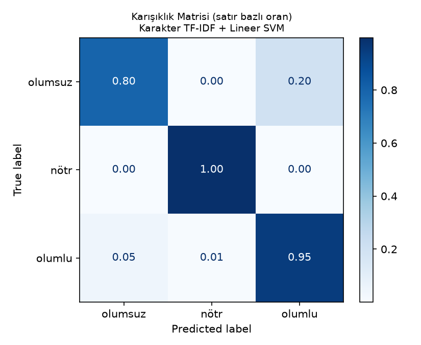
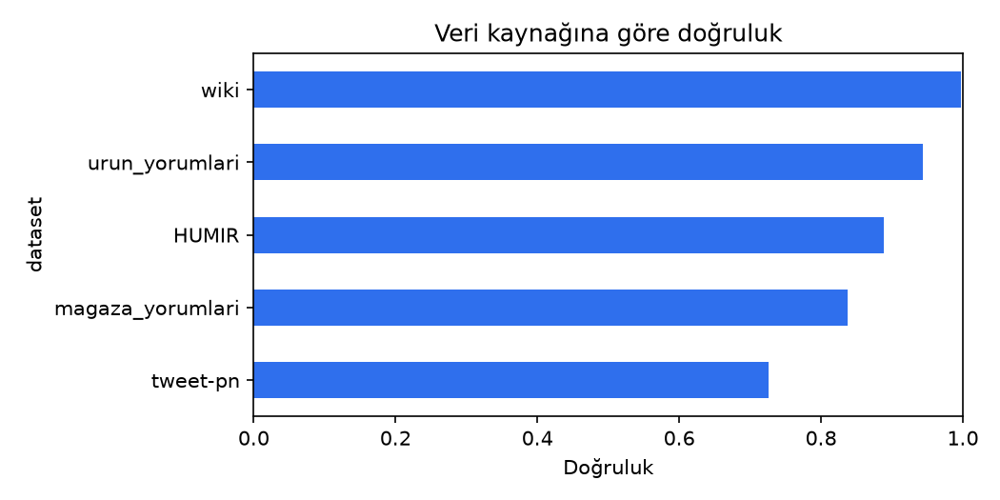

# 💬 Türkçe Duygu Analizi

[](https://github.com/sumeyyeealtintas/turkce-duygu-analizi/actions/workflows/test.yml)

Türkçe ürün yorumları, mağaza yorumları ve tweetlerde **olumlu / nötr / olumsuz** duyguyu sınıflandıran NLP projesi. Sadece skor vermekle kalmaz; veri setinin zayıflıklarını (yapay olarak kolay nötr sınıfı, sınıf dengesizliği) tespit edip değerlendirmeyi buna göre dürüstçe raporlar.



## 🧰 Teknolojiler
Python · scikit-learn (TF-IDF, Lojistik Regresyon, Lineer SVM) · pandas · matplotlib · pytest

## 📦 Veri
- **Kaynak:** [winvoker/turkish-sentiment-analysis-dataset](https://huggingface.co/datasets/winvoker/turkish-sentiment-analysis-dataset) (Hugging Face), **CC BY-SA 4.0**
- 440.679 eğitim + 48.965 test cümlesi; kaynaklar: ürün yorumları, HUMIR (film), mağaza yorumları, tweetler, Vikipedi
- Lisans ve boyut nedeniyle veri **repoya konmaz**, ilk çalıştırmada otomatik indirilir

## 🔍 Yöntem
1. **Türkçe'ye özgü ön işleme** (`src/metin.py`): Python'un `lower()` fonksiyonu Türkçe'de `I→ı` ve `İ→i` dönüşümünü yanlış yapar (`"ISPARTA".lower()` yanlış sonuç verir). Bunu düzelttim ve testle doğruladım. Ayrıca bağlantı, etiket, sayı temizleme ve uzatılmış harfleri (`çoooook`) kısaltma
2. **İki farklı gösterim karşılaştırması**
   - *Sözcük TF-IDF* (tek ve ikili sözcükler) + Lojistik Regresyon
   - *Karakter TF-IDF* (2–5 karakterlik parçalar) + Lineer SVM. Türkçe gibi eklemeli dillerde `güzel / güzeldi / güzelmiş` aynı kökten beslenir
3. **Sınıf dengesizliği:** olumsuz sınıf verinin yalnızca %11,6'sı; `class_weight="balanced"` kullanıldı ve doğruluk yerine **makro-F1** raporlandı
4. **Veri sızıntısı kontrolü:** eğitim ve testte ortak olan 137 metin testten çıkarıldı
5. Eğitim: 120.000 örnek, test: 48.828 örnek

## 📊 Sonuçlar
| Model | Doğruluk | Makro-F1 (3 sınıf) | **Makro-F1 (olumlu/olumsuz)** | Olumsuz F1 |
|---|---|---|---|---|
| Çoğunluk sınıfı (referans) | 0.535 | 0.232 | 0.452 | 0.000 |
| Sözcük TF-IDF + Lojistik Reg. | 0.930 | 0.897 | 0.869 | 0.789 |
| **Karakter TF-IDF + Lineer SVM** | **0.948** | **0.912** | **0.873** | **0.791** |

### ⚠️ Bu sayılara dürüst bakış
Nötr sınıfı veri setinde **yalnızca Vikipedi cümlelerinden** geliyor. Model bunu duygu öğrenerek değil, "bu cümle ansiklopedi gibi mi?" diye bakarak çözebiliyor; Vikipedi'de doğruluğun %99,8 çıkması bunu gösteriyor. Bu yüzden genel doğruluk ve 3 sınıflı skor olduğundan **iyimser** görünür. Asıl duygu başarısını **olumlu/olumsuz makro-F1 = 0.873** ölçer, projenin gerçek sonucu budur.

| Kaynağa göre doğruluk | En ayırt edici sözcükler |
|---|---|
|  | **Olumlu:** mükemmel, harika, memnunum, süper, kaliteli, kullanışlı<br>**Olumsuz:** berbat, rezalet, beğenmedim, kötü, sıkıcı, vasat, iade, gereksiz |

Model en çok **tweet'lerde (%72,6)** zorlanıyor: kısa, argo ve imla hatalı metinler. Eğitim verisinin çoğu ürün yorumu olduğu için bu alan kayması beklenen bir durum.

## 🧪 Örnek Kullanım
```bash
python src/tahmin.py "Kargo çok hızlıydı, ürün tam beklediğim gibi"      # [olumlu]
python src/tahmin.py "Ürün bozuk geldi, iade ettim, hiç tavsiye etmiyorum" # [olumsuz]
python src/tahmin.py "Konya, İç Anadolu Bölgesi'nde bir ilidir"           # [nötr]
```

## 🚧 Bilinen Sınırlar
- **Olumsuzlama:** model `"Ürün güzel değil"` cümlesini yanlışlıkla **olumlu** buluyor. Sözcük/karakter torbası yaklaşımı `değil` ile `güzel` arasındaki ilişkiyi yakalayamaz. Bu sınıf yaklaşımların temel zayıflığıdır; çözüm için bağlam anlayan modeller (BERT) gerekir.
- İroni ve alaycılık yakalanamaz
- Eğitim verisi ağırlıklı olarak ürün yorumudur; başka alanlarda (haber, siyaset) performans düşer
- Veri setinde küfür içeren metinler bulunur

## 🚀 Çalıştırma
```bash
pip install -r requirements.txt
python src/egit.py          # veriyi indirir (~81 MB), 3 modeli eğitir, raporları üretir (~3 dk)
python src/tahmin.py        # etkileşimli tahmin
pytest -q                   # 6 test
```

## 📁 Yapı
```
├── src/
│   ├── metin.py    # Türkçe ön işleme
│   ├── veri.py     # veri indirme / yükleme
│   ├── egit.py     # eğitim ve değerlendirme
│   └── tahmin.py   # komut satırından tahmin
├── tests/          # ön işleme testleri
└── raporlar/       # grafikler ve metrikler
```

## 🔭 Geliştirme Fikirleri
- Türkçe BERT (`dbmdz/bert-base-turkish-cased`) ile ince ayar ve karşılaştırma
- Olumsuzlama için olumsuzluk ekleri (`-me/-ma`) ve `değil` işaretleme özelliği
- Alan kayması için tweet verisiyle ek eğitim
- Modeli FastAPI ile servise çevirme (bkz. `churn-tahmin-api` yapısı)

*Veri: winvoker/turkish-sentiment-analysis-dataset, CC BY-SA 4.0.*
